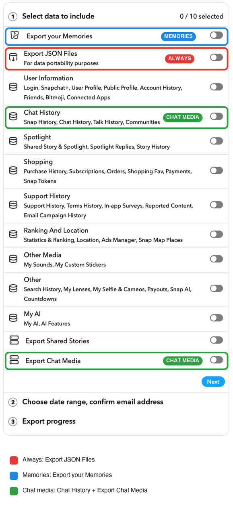

# snapchat-export-tools

Turns a Snapchat "My Data" export into normal, correctly dated photos and
videos you can drop into Immich, Apple Photos, Google Photos, etc.

When exporting your data, **always select JSON** as well.

- **`snap_memories.py`**: your saved memories
- **`snap_chat_media.py`**: photos, videos and voice notes saved in chats, one folder per conversation

## What it fixes

**Memories**
- Matches each file to its date and location by exact timestamp. The JSON has
  no file IDs, but each zip entry's mtime equals its JSON `Date` to the second.
- Burns caption/sticker overlays into photos and videos.
- Writes capture time, UTC offset and GPS (videos too). The timezone comes
  from the GPS, or the nearest GPS fix within 30 days.
- Joins multi-snap / Spectacles recordings that were split into 10s pieces.
- Drops duplicates. They go to `_review/duplicates` so you can double-check.

**Chat media**
- Links files to their message through `chat_history.json` media IDs, or by
  timestamp for files with no ID.
- Snapchat often saves a chat snap three times (full-res, a low-res copy, and
  the overlay on its own). It keeps the full-res one and burns the overlay in.
- Puts the sender and conversation in the description, e.g.
  `Snapchat: from alice in Weekend Plans`.
- Joins multi-snaps (sent as one message per 10s segment) back into one
  video, within a conversation.
- Voice notes come out as `.m4a`.
- Sorts photos that weren't taken with the camera into subfolders of the
  conversation: `stickers/` for GIFs, Bitmoji/memoji and cutouts, and
  `memes/` for screenshots and images that are mostly text (tweets, memes).
  Text is found with `tesseract`, which the Docker image has. Without it, only
  GIFs, cutouts and PNG screenshots get sorted. Videos aren't sorted.
- A snap sent more than once (forwarded, re-sent to a group) is kept once per
  send. `--skip-resends` keeps only the first send in each folder; the rest
  show up in `_report.csv` as `skipped-resend`.

Each run writes a `_report.csv` that says what happened to every file.

## Getting your export

Snapchat -> Settings -> My Data. Pick what you want:

- **Export JSON Files** (red): always. The dates, locations and
  conversations all come from the JSON.
- **Export your Memories** (blue): your saved snaps and Memories.
- **Chat History** and **Export Chat Media** (green): chat photos, videos and
  voice notes. You need both, plus the JSON. Without Chat History the scripts
  can't tell who a file came from, so everything lands in
  `chat_media/_unknown`.

On the next step set the date range to everything, then submit. Snapchat
emails you when it's ready.



It arrives as one or more `mydata~<number>.zip` files. **Don't unzip them.**
The scripts read the zips directly, and need them as-is because that's where
the timestamps are.

## Docker

```sh
docker run --rm --user "$(id -u):$(id -g)" \
  -v ~/Downloads/snapchat:/in:ro \
  -v ~/Pictures/snapchat:/out \
  miacox/snapchat-export-tools /out /in --chat-media --tz America/Winnipeg
```

`/in` is a folder with the zips in it. Leave off `--chat-media` for memories
only.

Or with compose (edit `compose.yaml`, or set the variables in a `.env`):

```sh
SNAP_IN=~/Downloads/snapchat SNAP_OUT=~/Pictures/snapchat SNAP_TZ=America/Winnipeg \
  docker compose run --rm snapchat
```

For chat media only:

```sh
docker run --rm --user "$(id -u):$(id -g)" -v ~/Downloads/snapchat:/in:ro -v ~/Pictures/snapchat:/out \
  --entrypoint python miacox/snapchat-export-tools /app/snap_chat_media.py /out/chat_media /in
```

### Adding a newer export

Add `--merge` to put a newer chat media export into a folder you already
made, instead of starting over:

```sh
docker run --rm --user "$(id -u):$(id -g)" -v ~/Downloads/snapchat-new:/in:ro -v ~/Pictures/snapchat:/out \
  --entrypoint python miacox/snapchat-export-tools /app/snap_chat_media.py /out/chat_media /in --merge
```

It reads the earlier `_report.csv` and skips snaps that were already
exported. New files never take a name that's already in the folder, so
nothing gets overwritten. A short export usually has no memories in it,
which means no GPS, so it uses the timezone of the nearest earlier file that
had one (within 30 days) before falling back to `--tz`. Files that failed
last time are tried again, and new rows are added to `_report.csv`. Use the
same `--tz`, `--no-sort` and `--skip-resends` you used the first time.

## Without Docker

Needs Python 3.9+, `ffmpeg` and `exiftool` on your PATH. `tesseract` is
optional, it's used to spot memes.

```sh
python3 -m venv .venv
.venv/bin/pip install -r requirements.txt
.venv/bin/python snap_memories.py OUT_DIR mydata~*.zip [--chat-media]
.venv/bin/python snap_chat_media.py OUT_DIR mydata~*.zip
```

## Options

| | |
|---|---|
| `--chat-media` | (`snap_memories.py`) also do chat media, into `OUT_DIR/chat_media` |
| `--tz ZONE` | timezone when there's no GPS fix within 30 days (default UTC) |
| `--workers N` | parallel jobs (default: CPU count - 2) |
| `--crf N` | x264 quality when a video has to be re-encoded (default 18) |
| `--no-sort` | don't move chat memes and stickers into subfolders |
| `--skip-resends` | keep only the first send of a chat snap that was sent more than once in the same conversation |
| `--merge` | (`snap_chat_media.py`) add to an earlier run in `OUT_DIR` instead of overwriting it, see [Adding a newer export](#adding-a-newer-export) |

Videos are only re-encoded when an overlay is burned in or segments are
joined. Everything else is copied as-is.

## Output

```
OUT_DIR/
  2024-06-28_184502.jpg          memories, named by local capture time
  _report.csv
  _review/duplicates/            dropped duplicates
  _review/orphan_overlays/       overlays with no main file in the export
  chat_media/
    alice/2026-10-19_031753.mp4
    alice/memes/2026-10-08_222304.jpg
    alice/stickers/2026-10-11_090112.gif
    Weekend Plans/2026-10-16_171517.mp4
    _report.csv
    _review/unpaired_overlays/   overlays it couldn't match to one snap
```

## Support

If this saved your memories, you can buy me a coffee:

[](https://ko-fi.com/barefootedbryan)

## Credit

The overlay compositing idea comes from
[evilpig/snapchat-memory-export-organizer](https://github.com/evilpig/snapchat-memory-export-organizer).
This is a separate implementation: it matches by exact timestamp instead of by
date, and adds GPS timezones, segment joining, duplicate handling and chat media.
